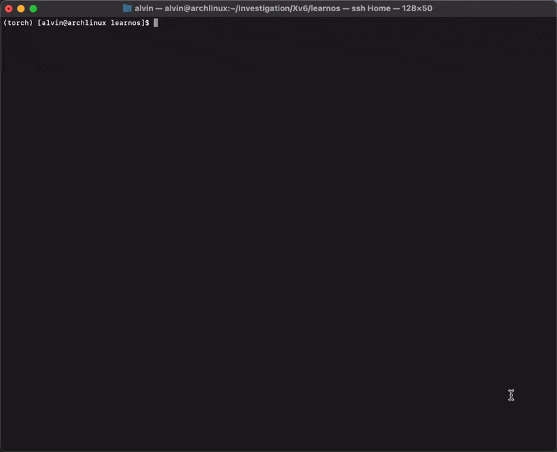

# SupremeOS — an xv6-riscv kernel with a real scheduler, allocator and System V IPC

> 中文版（含比赛报告与队伍信息）见 [README_CN.md](README_CN.md)

A teaching-grade Unix-like kernel for RISC-V, built on [MIT xv6-riscv](https://github.com/mit-pdos/xv6-riscv).
The upstream kernel has 21 system calls and a round-robin scheduler; this one has **43 system calls**,
a **multi-level feedback queue scheduler**, a **buddy + slab allocator** with lazy allocation and
copy-on-write, and **System V IPC** (shared memory, semaphores, message queues).



---

## What was actually built

| Module | What it does | Key files |
|---|---|---|
| **Scheduler** | Multi-level feedback queue (MLFQ) with preemption, per-level priority and time quantum, plus `set_priority`. Three policies — FCFS, round-robin, MLFQ — selected at runtime by the `chrt` syscall (`user/chrt.c`), defaulting to MLFQ. | `kernel/proc.c`, `user/chrt.c` |
| **Memory** | Buddy allocator for physical pages (free lists + bitmap), slab allocator on top of it for small objects, unified into `kmalloc`. Plus lazy allocation and copy-on-write. | `kernel/kalloc.c`, `kernel/slab.c` |
| **IPC** | System V-style shared memory (`shmget/shmat/shmdt/shmctl`), semaphores (`semget/semop/semctl`), message queues (`msgget/msgsnd/msgrcv/msgctl`), with owner/group/other permission bits. | `kernel/shm.c`, `kernel/semaphore.c`, `kernel/msg.c` |

The design rationale, data structures and test results for each module are written up in
[`doc/初赛文档.md`](doc/初赛文档.md) (also as PDF) — including address-space layout diagrams
and the buddy bitmap view.

---

## System calls

Numbers 1–21 are stock xv6. Everything from 22 up is new:
**22 added calls, 43 total.**

| # | Name | # | Name | # | Name |
|---|---|---|---|---|---|
| 22 | `getyear` | 30 | `shmat` | 38 | `msgsnd` |
| 23 | `gettimeofday` | 31 | `shmdt` | 39 | `msgrcv` |
| 24 | `trace` | 32 | `shmctl` | 40 | `msgctl` |
| 25 | `find` | 33 | `vfork` | 41 | `printMlfq` |
| 26 | `set_priority` | 34 | `semget` | 42 | `chrt` |
| 27 | `ticks` | 35 | `semop` | 43 | `neofetch` |
| 28 | `cycles` | 36 | `semctl` | | |
| 29 | `shmget` | 37 | `msgget` | | |

> Note on the count: the competition report says "19 new, 40 total" — that was the state at
> the preliminary round. `chrt`, `printMlfq` and `neofetch` were added afterwards.
> `getyear` / `gettimeofday` / `trace` / `find` / `vfork` come from the standard xv6 lab track;
> the IPC set, `set_priority`, `ticks`/`cycles` and the scheduler calls are ours.

---

## Running it

The easiest path is the Docker environment (RISC-V toolchain + QEMU preinstalled, no host setup):

```bash
docker pull linermao/xv6-riscv-env:latest
./start_docker.sh
```

Inside the container, or on a host with `riscv64-unknown-elf-gcc` and `qemu-system-riscv64`:

```bash
make qemu          # boot into the shell
make qemu-gdb      # wait for a debugger on :26000
```

Debugging from a second terminal:

```bash
gdb-multiarch
(gdb) target remote localhost:26000
(gdb) file kernel/kernel
```

`docker-compose.yml` builds from the local `dockerfile` if you'd rather not pull the image.

---

## Layout

```
kernel/          kernel sources (proc.c, kalloc.c, slab.c, shm.c, semaphore.c, msg.c, ...)
user/            user-space programs, including the test cases for each module
mkfs/            build helper for the filesystem image
doc/             初赛文档.md / .pdf, architecture images, demo video
Makefile         build + qemu targets
start_docker.sh  one-shot container launcher
```

### Test programs

Each feature has a userspace test under `user/`: `heaptest`, `spinlocktest`, `shmtest`,
`semtest`, `msgtest`, `vforktest`, `sche_test`, `chrt`, `ticks`, `tracetest`, `find`.
They're built into the image and runnable from the shell, e.g.:

```
$ sche_test
$ shmtest
```

---

## What's not done

From the original plan, still open (in rough priority order):

- CPU affinity in the scheduler; per-CPU caches for buddy/slab
- Kernel-level and user-level threads
- Deadlock detection/prevention for semaphore sets
- Page cache; signal support; file mapping and anonymous mapping
- VFS, FAT32 filesystem
- Networking: local sockets and hardware drivers
- A userspace toolchain (editor, compiler) inside the OS

---

## Contributors

Built for the "进栈不排队" team, OS-principles track, 2024:

- [wxz](https://github.com/Firefly-Star) — 温学周
- [Linermao](https://github.com/Linermao) — 林灿
- Advisor: 杨浩

## References

- [MIT xv6-riscv](https://github.com/mit-pdos/xv6-riscv)
- [xv6 book (Chinese)](https://th0ar.gitbooks.io/xv6-chinese/content/)
- [6.S081 All-In-One](https://xv6.dgs.zone/)

## License

[MIT](LICENSE)
